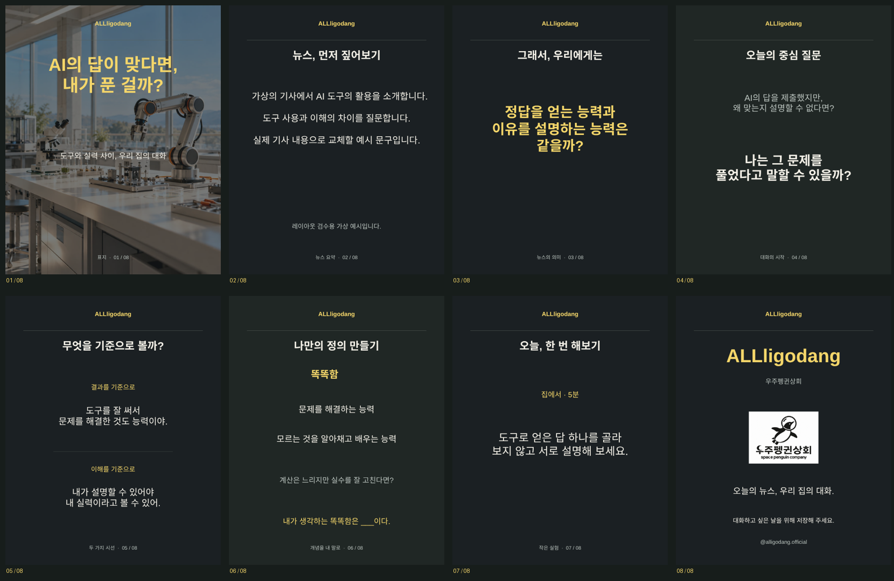
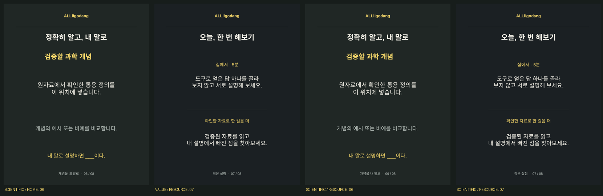

# ALLligodang · 읽는 뉴스 Canva 마스터

제작·확인일: 2026-11-04. 템플릿 버전 `reading-v1.1-20261104`, 필드 매핑 `family-dialogue-8/v1.1`.

## 실제 디자인과 현재 저장 상태

**모두 실제 Canva 디자인이다.** 1080×1350, 편집 가능한 8페이지를 제작했다. 아래의 검토 링크는 최종 글꼴·배치·자동 채우기 라벨을 적용한 **미저장 편집 초안**이다. Canva 편집 도구가 미리보기 후 사용자의 명시적 승인을 요구하므로, 영구 저장과 실제 Autofill 인수는 승인 뒤 진행한다.

| 구조 | 초안 검토 링크 | 원본 디자인 | 예상 필드 수 |
| --- | --- | --- | ---: |
| 가치 정의 · 집 활동 | [Canva에서 검토](https://www.canva.com/d/TKDWGBR_siDzk0m) | [DAHZ69ZFAeE](https://www.canva.com/d/0_t0Zxdi8W9cIHv) | 37 |
| 가치 정의 · 추가 자료 | [Canva에서 검토](https://www.canva.com/d/Q0qbPfB_916-tfh) | [DAHZ6wTUQBo](https://www.canva.com/d/7kpYAP-OBEjvMsd) | 39 |
| 과학 설명 · 집 활동 | [Canva에서 검토](https://www.canva.com/d/qdeIYvLOSryZqVF) | [DAHZ6_GVxE4](https://www.canva.com/d/Hr8JKy66zYVn25I) | 36 |
| 과학 설명 · 추가 자료 | [Canva에서 검토](https://www.canva.com/d/eC7xi-CMDU6WHjr) | [DAHZ6_H13uk](https://www.canva.com/d/qY9Nm8WSD-mW9OM) | 38 |

필드 수는 구현 어댑터와 초안 라벨의 목표 계약이다. 저장 후 조회한 실제 dataset 검증 결과라고 표시하지 않는다. 초안 링크는 거래가 끝나면 원본 디자인 링크로 확인한다. 디자인은 공개 게시하지 않았다.

## 실제 Canva 초안 8장 미리보기

페이지 역할은 표지·뉴스 요약·한 문장 시사점·중심 질문·두 시선·개념 정의·활동·닫는 표지다. 문구는 레이아웃 확인용 가상 예시이며 실제 기사 요약·AI 생성 품질의 증거가 아니다. 사진은 기존 저장소의 AI 연출 그림이다.

위 이미지는 로컬 렌더러로 Canva 화면을 흉내 낸 것이 아니라 Canva 편집 트랜잭션에서 받은 실제 페이지 썸네일이다. 개별 `draft-01.png`부터 `draft-08.png`도 같은 디렉터리에 보관했다. 최종 PNG export 인수는 별도다.

## 디자인 규칙

- 전면 사진형 표지, 차콜·딥그린 내지, 부드러운 흰색 문장, 버터 옐로 포인트.
- 중앙 정렬, 같은 위치의 브랜드·페이지 표시, 한 장의 중심 문장을 먼저 읽는 크기 차이.
- 5장은 상하 두 시선. 6장 두 모드 × 7장 두 활동 형식만 4개 마스터로 만든다.
- 집 활동만 있는 마스터에는 추가 자료 블록·구분선을 넣지 않는다. 빈 문자열이 요소를 자동 제거한다고 가정하지 않는다.
- 제목·본문·그림은 독립 요소다. 표지와 2~7장 배경은 개별 이미지 필드이며 PNG에 문구를 굽지 않는다.
- 승인된 우주펭귄상회 PNG는 원본 그대로 사용한다. 레퍼런스의 영화 사진·Canva 로고·특정 유료 글꼴은 복사하지 않는다.
- 가이드 예산에 맞춰 표지 3줄, 질문 4줄, 관점 본문 각 3줄, 개념·빈칸 2줄, 활동 4줄, CTA 2줄 공간을 확보했다. 실제 자동 줄바꿈·긴 문구 export 검수는 인수 단계에서 확인해야 한다.

## 전체 필드 매핑

| 페이지 | 공개 텍스트 필드 | 이미지 필드 |
| --- | --- | --- |
| 1 표지 | `P01_HEADLINE`, `P01_SUBTITLE` | `P01_IMAGE` |
| 2 요약 | `P02_TITLE`, `P02_FACTS`, `P02_CAVEAT` | `P02_BACKGROUND` |
| 3 시사점 | `P03_TITLE`, `P03_TAKEAWAY` | `P03_BACKGROUND` |
| 4 질문 | `P04_TITLE`, `P04_SCENARIO`, `P04_QUESTION` | `P04_BACKGROUND` |
| 5 두 시선 | `P05_TITLE`, `P05_A_LABEL`, `P05_A_BODY`, `P05_B_LABEL`, `P05_B_BODY` | `P05_BACKGROUND` |
| 6 공통 | `P06_TITLE`, `P06_CONCEPT`, `P06_FILL_IN` | `P06_BACKGROUND` |
| 6 가치 정의 | `P06_DEFINITION_A`, `P06_DEFINITION_B`, `P06_BOUNDARY_CASE` | 공통 배경 사용 |
| 6 과학 설명 | `P06_ACCEPTED_DEFINITION`, `P06_EXAMPLE_OR_NON_EXAMPLE` | 공통 배경 사용 |
| 7 집 활동 | `P07_TITLE`, `P07_HOME_LABEL`, `P07_HOME_ACTION` | `P07_BACKGROUND` |
| 7 추가 자료 | `P07_OPTIONAL_LABEL`, `P07_OPTIONAL_ACTION` | 공통 배경 사용 |
| 8 닫는 표지 | `P08_BRAND_NAME`, `P08_PARENT_BRAND`, `P08_BRAND_LINE`, `P08_CTA`, `P08_HANDLE` | `P08_LOGO` |

`P02_FACTS`는 사실 2~3개를 순서대로 두 줄바꿈으로 결합한다. 선택 조건·상황은 없는 경우 빈 문자열로 보낸다. 현재 마스터는 이 선택 필드에 고정 외곽 패널이나 장식 프레임이 없으며, 실제 빈 값 입력 시 여백·배치는 export로 확인해야 한다.

출처 ID·내부 검수 메모·부모 가이드 전체는 공개 카드 필드에 넣지 않는다. 공개 캡션은 별도로 저장한다. 상단 브랜드와 페이지 번호는 정적 디자인 요소이며 Autofill 라벨에 포함하지 않는다. 현재 준비된 정적 브랜드는 ALLligodang 전용이다. 다른 채널은 그 채널의 마스터를 등록한다.

## 스튜디오 연결

1. **디자인 → Canva 8장 마스터**에서 현재 연결 계정·팀을 확인한다. 계정 연결 표시와 Autofill 사용 권한은 별개다.
2. 알리고당의 준비된 마스터에서 **이 마스터 검사·등록**을 누른다. 서버가 실제 8페이지·1080×1350·페이지 ID·수정 시각·전체 필드 타입을 확인한 경우에만 등록한다.
3. 원고의 6장 개념 모드·7장 추가 자료 여부로 등록된 마스터를 고른다. 원고와 페이지 이미지 설정을 먼저 저장한다.
4. **Canva 8장 만들기**는 선택 이미지의 밝기·초점·오버레이를 반영한 자산을 업로드하고, 전체 문구를 새 디자인에 채운다. 원본 마스터는 보존한다.
5. 실제 PNG 8장을 내려받아 영구 저장한다. 게시용 JPEG 8장은 해당 PNG에서 한 번 변환한다. 최종 미리보기와 게시 승인 파일은 같은 ID·hash·순서다.
6. Canva 수동 수정은 **최신 디자인 가져오기** 후 8장의 문구를 대조한다. 편집 링크만 열어서는 동기화되지 않는다.
7. 계정·한도·필드 변경·외부 접수 미확정은 오류별로 복구한다. 이미 만든 디자인은 새 Autofill 없이 연결하여 검수할 수 있다. 원고와 정상 출력 파일은 삭제하지 않는다.

## 16.9 인수 기준과 실제 확인 범위

| 인수 항목 | 현재 확인 | 남은 확인 |
| --- | --- | --- |
| 실제 8페이지와 순서 | Canva 페이지 메타데이터·초안 8장 확인 | 저장된 마스터 재조회 |
| 한글·그림 독립 편집·브랜드 | 네이티브 텍스트/이미지 요소와 실제 썸네일 확인 | 최종 저장 결과 |
| 긴/짧은 제목, 사실 2/3개, 선택 문구 | 칸 확대·사전 길이/줄 검사 구현 | 실제 Autofill 입력별 export |
| 개념·활동 4변형 | 실제 디자인 4개와 변형 페이지 제작 | 실제 서버가 각각 선택해 생성 |
| 표지·내지 배경 교체 | 라벨·자산 어댑터 구현 | 실제 export 반영 |
| dataset·마스터 변경 감지 | 전체 계약·hash·수정 시각·페이지 ID 검사 구현 | 영구 저장 후 실제 dataset |
| Autofill·PNG 8장 | REST 및 모의 응답 검사 구현 | 격리된 실제 외부 작업 |
| 수동 수정 재가져오기 | 버전 CAS·8장 검수·원본 보존 구현 | 실제 디자인 수정 후 재가져오기 |
| 중복·만료·부분 실패·미확정 | UI·순수 로직 검사 및 실제 PG CI 회귀 | 정확한 CI head 결과 확인 |
| 미리보기/게시 hash 일치 | PNG/JPEG 보관·순서·승인 guard 구현 | 실제 export와 최종 승인 파일 비교 |

실제 외부 인수가 끝나기 전에는 ‘8장 Canva 자동화 완료’라고 보고하거나 공개 SaaS 출시 준비가 끝났다고 표시하지 않는다. 공식 Get Design Pages preview API의 공개 앱 심사 제한도 [릴리스 문서](NEWS_EDITORIAL_RELEASE_20261104.md)에 남겼다.

## 재현 코드

- `scripts/build-canva-masters.mjs`: 승인 자산·네이티브 텍스트/이미지/도형의 HTML 및 layout JSON 원본을 생성한다.
- `shared/canvaMasterCatalog.ts`: 실제 마스터 ID·버전·링크. 이 catalog는 사용 가능 여부를 하드코딩하지 않는다.
- `shared/canvaEditorial.ts`: 작성 데이터에서 모든 필드를 변환하고 dataset 타입·변형을 검사한다.
- `shared/canvaTextLimits.ts`: 준비된 4개 버전의 고정 텍스트 칸 사전 점검. 원고를 변경하지 않는다.
- `server/services/canvaEditorial.ts`: 서버의 내구성 있는 생성·조회·export·복구 단계.
- `server/services/canvaPublication.ts`: 현재 원고·캡션·근거·실제 8장 파일의 승인 조건.

공식 근거는 [Autofill 가이드](https://www.canva.dev/docs/apps/rest-apis/autofill-guide/), [Create design autofill job](https://www.canva.dev/docs/apps/rest-apis/reference/autofills/create-design-autofill-job/), [Get design export job](https://www.canva.dev/docs/apps/rest-apis/reference/exports/get-design-export-job/), [Get design pages](https://www.canva.dev/docs/apps/rest-apis/reference/designs/get-design-pages/)를 2026-11-04 확인했다.
